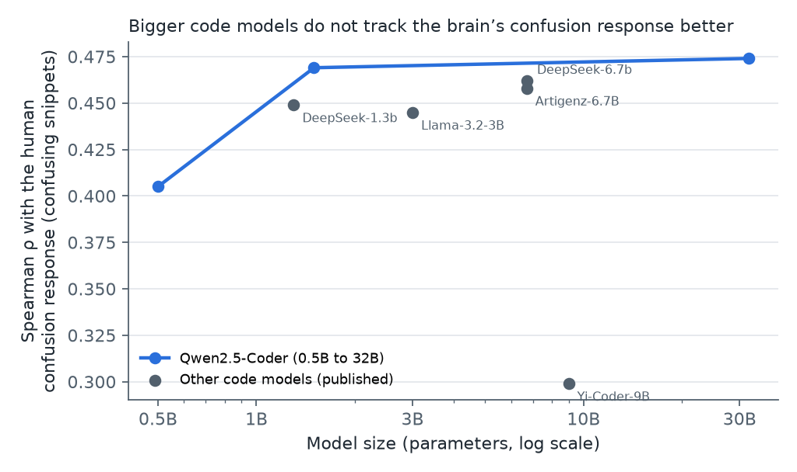
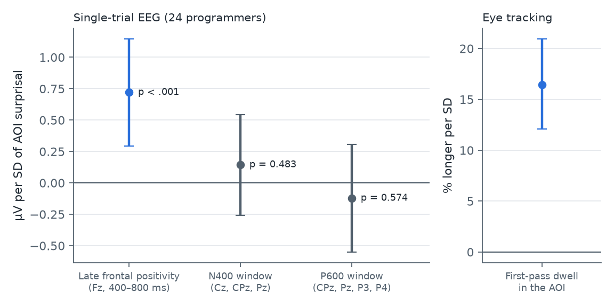

# Who Reads This Code?

**Interpretable models of how programmers read code, and AI explanations that adapt to them faithfully**

[Project page](https://sayamrina.github.io/who-reads-this-code/) · [Live demo](https://who-read-thiscode.streamlit.app/) · [Preregistration](PREREGISTRATION.md) · [Portfolio](https://sayamrina.github.io/)

AI coding assistants explain code in the same way to everyone, although programmers differ a great deal in how they read it. This project asks two questions with public eye-tracking data and a small generation experiment:

1. Can signals that are known to shape text reading, such as how predictable a word is, also explain how long programmers look at parts of code, and do readers fall into interpretable types?
2. If an assistant adapts its explanations to a developer profile, does the adaptation stay where it should, or does it leak into unrelated parts of the explanation?

The hypotheses and analysis plan were written down in [PREREGISTRATION.md](PREREGISTRATION.md) before the gaze data were loaded; every deviation is listed there.

## Data

EMIP, the Eye Movements in Programming dataset (Bednarik et al., 2020; CC-BY 4.0): 216 programmers read two short programs (*Rectangle*, *Vehicle*) while an SMI RED250 tracker recorded their gaze at 250 Hz, and answered a comprehension question about each. The dataset ships token-level areas of interest that align one-to-one with the whitespace-separated tokens of the source files (Al Madi et al., 2021), so gaze can be mapped to code without guessing positions.

**Analysed sample.** 207 participants read Java. After the preregistered exclusions (tracking loss above 30 %, gaze mostly off the code) and one added rule (fewer than 30 fixations), **351 trials from 185 participants** remain, giving 44,912 token observations.

**Pipeline** (`src/`): samples are averaged over the valid eyes, fixations are detected with a dispersion threshold (I-DT, 25 px, 80–1,200 ms; Salvucci and Goldberg, 2000), and each fixation is assigned to the token box it falls in (10 px tolerance). Per token we compute total reading time, first-pass gaze duration and skipping, as in text-reading research.

## Part A: EMIP

## Study 1: predictability shapes how long code is read

Token surprisal, −log₂ p(token | preceding code), comes from Qwen2.5-Coder-0.5B and is summed over the sub-word pieces of each code token. Linear mixed-effects models on log reading time include crossed random intercepts for participants and token items, and control for token length, line, position in the line and token frequency. (A first version nested items within participants; the correction is logged in the preregistration.)


| Hypothesis | Result |
|---|---|
| **H1** Higher surprisal, longer reading | **Supported in the preregistered model for total reading time**: +4.7 ms per bit at the mean (b = 0.040 on log time per SD, SE = 0.014, p = .004, 19,186 observations, crossed random intercepts for readers and tokens). First-pass gaze: same direction, not significant (b = 0.012, p = .12). **Not robust in the checks**: a by-item regression on token means points the same way but is not significant (p = .16), and neither program alone reaches significance (Rectangle p = .07, Vehicle p = .10). |
| **H2** The effect differs by expertise | **Not supported**: no surprisal × expertise interaction (total time b = −0.006, p = .37). |
| **H3** Predictable tokens are skipped more | **Not supported**: b = 0.026, p = .11. |

Surprisal and token length are uncorrelated in these programs (r = .01), so the effect is not a length effect in disguise.

## Study 1b: two interpretable reading strategies

Per trial we measured how often a line change goes to the next line, how often it goes back, the regression rate, mean fixation duration and coverage. k-means on the standardised features (k = 2 chosen by silhouette) gives two types, each described by its most distinctive features:


- **Type 1, linear** (107 trials): reads line by line and rarely goes back.
- **Type 2, non-linear** (244 trials): jumps between distant lines and often returns to earlier ones.

The non-linear type is associated with higher self-rated expertise (Kruskal–Wallis H = 4.52, p = .03), in line with the finding that experienced programmers read code less linearly (Busjahn et al., 2015). The types did not differ in comprehension accuracy (χ² = 1.58, p = .21). This analysis was exploratory.

## Study 2: does a profile-conditioned explanation change only where it should?

A developer profile marks the programming constructs in each program (constructor, `this.` fields, object creation, `if`/`else`, …; 13 rule-based constructs) as known or unknown. The baseline developer knows arithmetic, printing, `return` and class declarations. Two systems explain the code to this developer with gpt-4o-mini:

- **Profile in the prompt.** The profile is written into the prompt, and the model writes line-by-line notes directly.
- **RSA-style selection.** The model writes one note per (line, construct) pair once, without any profile. A speaker then picks, for each line, the subset of notes that maximises α · log L₀ − cost, where L₀ is a literal listener that understands a line when every construct on it is known or explained (Goodman and Frank, 2016).

**Faithfulness test.** Flip one unknown construct to known (7 flips per program) and record which lines' explanations change (text similarity below 0.6). A faithful system changes only lines that use the flipped construct.


| | Lines using the flipped construct that changed | **Other lines that changed** |
|---|---|---|
| Profile in the prompt | 40 % (14 of 35) | **13 % (41 of 307)** |
| RSA-style selection | 69 % (24 of 35) | **0 % (0 of 307)** |

Rerunning the prompt-only system with an unchanged profile changed 0–2.5 % of lines across two runs, so the 13 % is not run-to-run noise: telling a model about a developer changes its explanation in places that have nothing to do with the change. The RSA-style system is local by construction, because it separates *what* to explain (chosen from the profile) from *how* to say it (written once); the experiment shows what this separation buys. Its targeted change rate is below 100 % because removing one of several notes on a line can leave the line's text above the similarity threshold.

All notes cite their line; 100 % of the prompt-only notes referred to an existing line.

## Part B: open questions from the Saarland EEG studies

Two recent studies from Saarland University measured programmers' brain responses to confusing code. Bergum et al. (2026) recorded EEG and eye tracking while 24 programmers read 72 pairs of Java snippets with and without an *atom of confusion*, and found a late frontal positivity about 400–700 ms after the first fixation on the confusing part. Abdelsalam et al. (2025) showed that the perplexity of code language models peaks where this response is large. Both papers list open questions: individual differences were not analysed, eye-tracking measures were not tested inferentially, only one EEG component was examined, the effect of model size is unknown, and detection and assistance were proposed but not built. Their data and code are public (Zenodo 10.5281/zenodo.14229848; github.com/brains-on-code), so Studies 3–6 address these questions directly. The hypotheses were added to the [preregistration](PREREGISTRATION.md) before these analyses were run.

| Open question in Bergum et al. (2026) and Abdelsalam et al. (2026) | Where it is tested here | Answer |
|---|---|---|
| Q1 Individual differences; can prior knowledge enter the model? | Studies 1, 4 | The surprisal effect does not depend on experience, in EEG, dwell time or EMIP reading times |
| Q2 Snippet means only; eye tracking not tested inferentially | Studies 1, 4 | Surprisal predicts single-trial EEG beyond the label, and dwell time; EMIP effect weaker |
| Q3 Only one EEG component | Study 4 | No N400 or P600 effect; the response is specific |
| Q4 Does model size matter? | Study 3 | No: 1.5B matches 32B |
| Q5 Detection at 64 %; assistance not built or evaluated | Studies 2, 5, demo | Gaze adds nothing to perplexity; faithful RSA selection and a demo exist; a user study is still missing |
| Q6 RSA listeners set by hand | Study 6 | A listener learned from reading times stays faithful |

**In short:** code-model predictability tracks *where* programmers struggle, but not *which* programmer struggles more. Personal differences have to be modelled, not assumed, and an assistant's adaptation has to be built into how it selects content, not requested in a prompt.

**Replication first.** Our own perplexity code reproduces the published AOI perplexities of deepseek-coder-1.3b-base exactly (Pearson r = 1.00 over all 144 snippets), so new models can be compared with the published ones on the same footing.

### Study 3: does a bigger model track the brain better?

For each model, the Spearman correlation between maximum AOI perplexity and the snippet-mean late frontal positivity on the 72 confusing snippets (their RQ2), and the likelihood-ratio gain when AOI surprisal is added to a single-trial model that already contains the confusing/clean label. Qwen2.5-Coder 0.5B and 1.5B were run by us; the other values use the published perplexities.



| Model | Size | ρ (confusing snippets) | LR gain, single trials |
|---|---|---|---|
| Qwen2.5-Coder-0.5B (ours) | 0.5B | .41 | 7.2 |
| deepseek-coder-1.3b-base | 1.3B | .45 | 4.6 |
| Qwen2.5-Coder-1.5B (ours) | 1.5B | **.47** | **7.2** |
| Llama-3.2-3B | 3B | .45 | 8.2 |
| deepseek-coder-6.7b-base | 6.7B | .46 | 5.3 |
| Artigenz-Coder-DS-6.7B | 6.7B | .46 | fit failed |
| Yi-Coder-9B | 9B | .30 | 3.3 |
| Qwen2.5-Coder-32B | 32B | **.47** | 5.3 |

**H5 supported**: alignment does not grow with size. Within one family, the 1.5B model matches the 32B model on snippet means (ρ = .47 for both) and fits single trials better, and the 9B model is the weakest of all. This mirrors the finding that larger transformers fit human reading times less well (Oh and Schuler, 2023), now for code and for a neural response. With eight models and four sizes per family at most, this is a descriptive pattern, not a fitted scaling law; the Artigenz single-trial fit did not converge (negative likelihood gain) and is not interpreted.

### Study 4: single trials, individual differences and other components

Single-trial fixation-related potentials (1,387 trials, 24 programmers), first-pass dwell time in the area of interest, and years of programming experience from the questionnaire; AOI surprisal is log₂ of the maximum AOI perplexity of Qwen2.5-Coder-32B. Linear mixed-effects models with crossed random intercepts for programmers and snippet pairs.



| Hypothesis | Result |
|---|---|
| **H6** Surprisal predicts the single-trial late frontal positivity (Fz, 400–800 ms) | **Supported**: +0.73 µV per SD (SE = 0.22, p < .001). It **remains when the confusing/clean label is in the model** (b = 0.57, p = .02), while the label itself is no longer significant (p = .14): graded predictability explains the response better than the binary label. By-snippet check: p = .02. |
| **H7** The effect depends on programming experience | **Not supported** (interaction p = .97). More experienced programmers show a smaller positivity overall (b = −0.21 µV per year, p = .008; exploratory, 24 people). |
| **H8** Surprisal also predicts N400 and P600 windows | **Not supported**: N400 window b = 0.14, p = .48; P600 window b = −0.12, p = .57. The response is specific to the late frontal positivity. |
| **H9** Surprisal predicts first-pass dwell time in the AOI | **Supported**: 16 % longer per SD (b = 0.152 on log seconds, p < .001), also beyond the confusing/clean label (label p = .46); no dependence on experience (p = .94). By-snippet check: p < .001. |

The missing expertise interaction matches Study 1 on EMIP: in two datasets, with eye tracking and with EEG, experience shifts overall reading but not how strongly predictability matters.

### Study 5: do gaze and perplexity together detect confusing code better?

Snippet-level classification of confusing vs. clean versions, leave-one-pair-out logistic regression.

| Features | AUC | Accuracy |
|---|---|---|
| AOI perplexity (Qwen2.5-Coder-32B) | **0.72** | 0.63 |
| Mean first-pass dwell across readers | 0.56 | 0.55 |
| Both | 0.72 | 0.60 |

**H10 not supported**: adding gaze does not improve detection (AUC difference −0.002, 95 % bootstrap CI −0.015 to 0.011). Averaged first-pass dwell is a weak signal on these short snippets; the useful human information seems to be in the EEG response, not in coarse dwell times.

### Study 6: an RSA listener learned from human reading data

Study 2 used a listener with hand-set probabilities. Here the listener is estimated from EMIP: for each construct, how much longer lower-expertise readers spend on lines that contain it than other readers, after removing what length, position, frequency and surprisal explain. Novices spend most extra time on `String[] args` and `main`, constructors, field declarations and class headers, and least on arithmetic and `if`/`else`. With this learned listener, the RSA speaker gives a novice profile 26 notes for *Rectangle* and 20 for *Vehicle*, and an experienced profile 5 and 9 (mainly `this.` fields and constructors). Flipping one construct to known still changes only the lines that use it (0 % of other lines). Exploratory: the learned part is the ranking of constructs; the mapping from extra reading time to a probability is set by hand.

## Demo

The [Streamlit app](https://who-read-thiscode.streamlit.app/) replays eight real EMIP sessions on the code image. A line is flagged when the reader dwells on it at least twice as long as on their median line or returns to it unusually often; for flagged lines, the assistant shows the notes the RSA-style speaker selects for the profile ticked in the sidebar, and says why the line was flagged. A box under the title names the data source (EMIP on OSF) and the methods. The demo makes no model calls; a step-by-step guide is on the [project page](https://sayamrina.github.io/who-reads-this-code/#how-the-app-works).

## Limitations

- **Small, specific stimuli.** Two short Java programs in Part A and short snippets with 24 programmers in Part B; effects may differ for longer or real-world code.
- **Fixation detection.** The I-DT settings split long fixations (mean fixation 135 ms, below typical values), so absolute durations are short; comparisons between tokens and readers remain valid, but first-pass measures are sparse.
- **Model structure.** Random intercepts only; random slopes were not fitted. Expertise is self-rated.
- **Study 2 is a mechanism test, not a user study.** It shows where explanations change, not whether developers understand them better. No participant read the generated explanations, and the construct rules and listener parameters were set by hand.
- **EEG only from published epochs.** Part B uses the artifact-corrected epochs published by Bergum et al.; we did not reprocess raw EEG. The demo's flagging rule is simple and not validated against comprehension.

## Run it

```bash
python -m venv .venv && . .venv/bin/activate
pip install torch --index-url https://download.pytorch.org/whl/cpu
pip install transformers pandas statsmodels scikit-learn matplotlib streamlit openai pillow pytest
# download EMIP (515 MB) from https://osf.io/53kts and unzip into data/raw/emip/
python src/surprisal_run.py      # token surprisal (writes results/surprisal.json)
python src/build_dataset.py      # fixations, token and trial tables, exclusions
python src/study1.py && python src/study1b.py
OPENAI_API_KEY=... python src/study2.py
python src/figures.py && python src/demo_data.py
# Part B: Saarland EEG data (Zenodo 10.5281/zenodo.14229848: results.zip, figure data.zip) into data/raw/aoc_frp/,
# and git clone https://github.com/brains-on-code/llm-perplexity-AoC into data/raw/aoc_frp/
python -I src/aoc/perplexity_scaling.py data/raw/aoc_frp/llm-perplexity-AoC deepseek-ai/deepseek-coder-1.3b-base
python -I src/aoc/compare_replication.py results/aoc/ppl_deepseek-coder-1.3b-base.json \
  data/raw/aoc_frp/llm-perplexity-AoC/model_results/deepseek-coder-1.3b-base/pairwise_analysis/pairwise_comparisons/perplexity_stats.csv
python -I src/aoc/perplexity_scaling.py data/raw/aoc_frp/llm-perplexity-AoC Qwen/Qwen2.5-Coder-0.5B   # and -1.5B
python -I src/aoc/build_trials.py data/raw/aoc_frp && python -I src/aoc/study4.py
python -I src/aoc/study3.py data/raw/aoc_frp && python -I src/aoc/study5.py && python src/study6.py
streamlit run app/streamlit_app.py
pytest
```

## References

Al Madi, N., Guarnera, D.T., Sharif, B. and Maletic, J.I. (2021) ‘EMIP Toolkit: a Python library for customized post-processing of the eye movements in programming dataset’, in *ACM Symposium on Eye Tracking Research and Applications (ETRA ’21 Short Papers)*. New York: ACM.

Bednarik, R. et al. (2020) ‘EMIP: the eye movements in programming dataset’, *Science of Computer Programming*, 198, 102520.

Busjahn, T. et al. (2015) ‘Eye movements in code reading: relaxing the linear order’, in *Proceedings of the 23rd IEEE International Conference on Program Comprehension (ICPC)*. Florence: IEEE, pp. 255–265.

Demberg, V. and Keller, F. (2008) ‘Data from eye-tracking corpora as evidence for theories of syntactic processing complexity’, *Cognition*, 109(2), pp. 193–210.

Bergum, A., Maurer, A.-M., Peitek, N., Bader, R., Mecklinger, A., Demberg, V., Siegmund, J. and Apel, S. (2026) ‘Fixation-related potentials reveal that confusing program code elicits a late frontal positivity’, *Scientific Reports*, 16, 16833.

Abdelsalam, Y., Peitek, N., Maurer, A.-M., Toneva, M. and Apel, S. (2025) ‘How do humans and LLMs process confusing code?’, *arXiv*, 2508.18547. Accepted at ICSE 2026.

Oh, B.-D. and Schuler, W. (2023) ‘Why does surprisal from larger transformer-based language models provide a poorer fit to human reading times?’, *Transactions of the Association for Computational Linguistics*, 11, pp. 336–350.

Goodman, N.D. and Frank, M.C. (2016) ‘Pragmatic language interpretation as probabilistic inference’, *Trends in Cognitive Sciences*, 20(11), pp. 818–829.

Salvucci, D.D. and Goldberg, J.H. (2000) ‘Identifying fixations and saccades in eye-tracking protocols’, in *Proceedings of the 2000 Symposium on Eye Tracking Research and Applications (ETRA)*. New York: ACM, pp. 71–78.

## Licence and credits

Code: MIT. EMIP data and stimulus images: © the EMIP authors, CC-BY 4.0 (Bednarik et al., 2020); a small extract for the demo is included in `app/data/`. EEG-derived tables in `results/aoc/` are computed from the data of Bergum et al. (2026), CC-BY 4.0; published perplexities from Abdelsalam et al. (2026), CC-BY-SA 4.0.

This project was built by Amrina, with AI as a supporting tool for coding.
