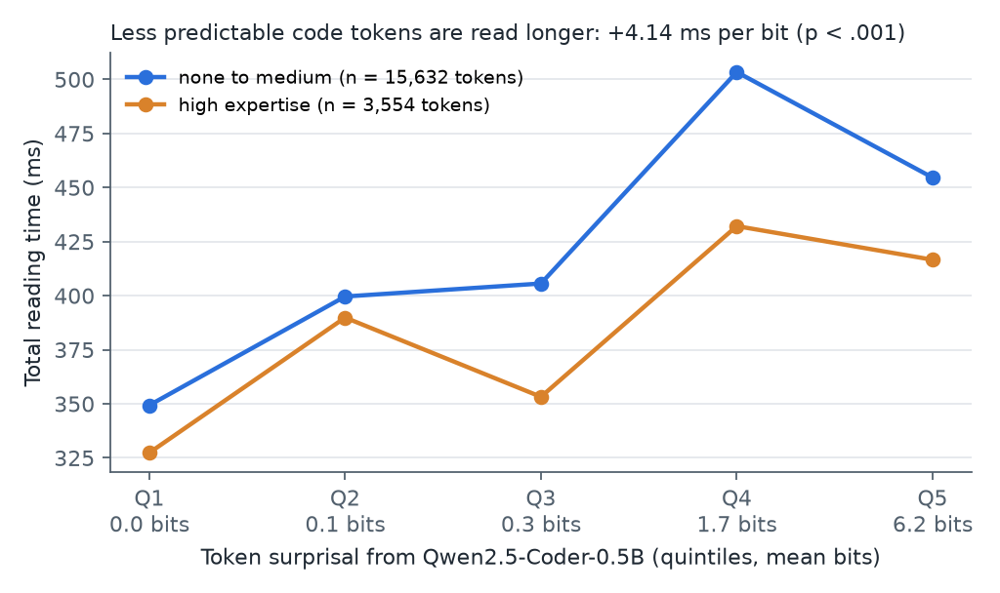
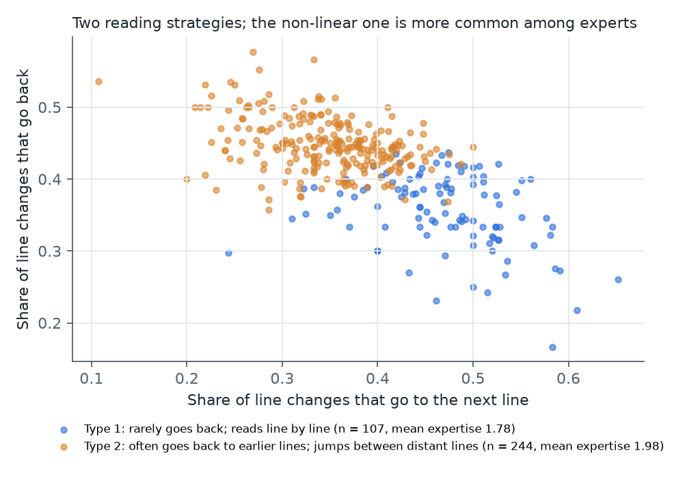
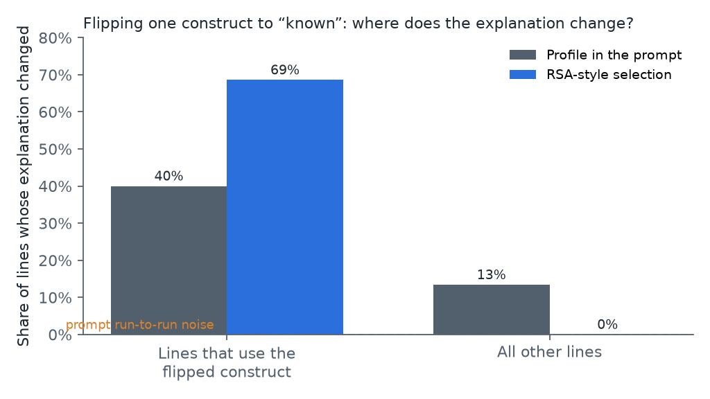

# Who Reads This Code?

**Interpretable models of how programmers read code, and AI explanations that adapt to them faithfully**

[Project page](https://sayamrina.github.io/who-reads-this-code/) · [Live demo](https://who-reads-this-code.streamlit.app/) · [Preregistration](PREREGISTRATION.md) · [Portfolio](https://sayamrina.github.io/)

AI coding assistants explain code in the same way to everyone, although programmers differ a great deal in how they read it. This project asks two questions with public eye-tracking data and a small generation experiment:

1. Can signals that are known to shape text reading, such as how predictable a word is, also explain how long programmers look at parts of code, and do readers fall into interpretable types?
2. If an assistant adapts its explanations to a developer profile, does the adaptation stay where it should, or does it leak into unrelated parts of the explanation?

The hypotheses and analysis plan were written down in [PREREGISTRATION.md](PREREGISTRATION.md) before the gaze data were loaded; every deviation is listed there.

## Data

EMIP, the Eye Movements in Programming dataset (Bednarik et al., 2020; CC-BY 4.0): 216 programmers read two short programs (*Rectangle*, *Vehicle*) while an SMI RED250 tracker recorded their gaze at 250 Hz, and answered a comprehension question about each. The dataset ships token-level areas of interest that align one-to-one with the whitespace-separated tokens of the source files (Al Madi et al., 2021), so gaze can be mapped to code without guessing positions.

**Analysed sample.** 207 participants read Java. After the preregistered exclusions (tracking loss above 30 %, gaze mostly off the code) and one added rule (fewer than 30 fixations), **351 trials from 185 participants** remain, giving 44,912 token observations.

**Pipeline** (`src/`): samples are averaged over the valid eyes, fixations are detected with a dispersion threshold (I-DT, 25 px, 80–1,200 ms; Salvucci and Goldberg, 2000), and each fixation is assigned to the token box it falls in (10 px tolerance). Per token we compute total reading time, first-pass gaze duration and skipping, as in text-reading research.

## Study 1: predictability shapes how long code is read

Token surprisal, −log₂ p(token | preceding code), comes from Qwen2.5-Coder-0.5B and is summed over the sub-word pieces of each code token. Linear mixed-effects models on log reading time include random intercepts for participants and for token items, and control for token length, line, position in the line and token frequency.



| Hypothesis | Result |
|---|---|
| **H1** Higher surprisal, longer reading | **Supported for total reading time**: +4.1 ms per bit at the mean (b = 0.035 on log time per SD, SE = 0.006, p < .001, 19,186 observations). First-pass gaze: same direction, not significant (b = 0.012, p = .08), with few first-pass observations because code is read non-linearly. **Robust in both programs** separately (Rectangle p = .01, Vehicle p < .001). |
| **H2** The effect differs by expertise | **Not supported**: no surprisal × expertise interaction (total time b = −0.005, p = .48). |
| **H3** Predictable tokens are skipped more | **Not supported**: b = 0.026, p = .11. |

Surprisal and token length are uncorrelated in these programs (r = .01), so the effect is not a length effect in disguise.

## Study 1b: two interpretable reading strategies

Per trial we measured how often a line change goes to the next line, how often it goes back, the regression rate, mean fixation duration and coverage. k-means on the standardised features (k = 2 chosen by silhouette) gives two types, each described by its most distinctive features:



- **Type 1, linear** (107 trials): reads line by line and rarely goes back.
- **Type 2, non-linear** (244 trials): jumps between distant lines and often returns to earlier ones.

The non-linear type is associated with higher self-rated expertise (Kruskal–Wallis H = 4.52, p = .03), in line with the finding that experienced programmers read code less linearly (Busjahn et al., 2015). The types did not differ in comprehension accuracy (χ² = 1.58, p = .21). This analysis was exploratory.

## Study 2: does a profile-conditioned explanation change only where it should?

A developer profile marks the programming constructs in each program (constructor, `this.` fields, object creation, `if`/`else`, …; 13 rule-based constructs) as known or unknown. The baseline developer knows arithmetic, printing, `return` and class declarations. Two systems explain the code to this developer with gpt-4o-mini:

- **Profile in the prompt.** The profile is written into the prompt, and the model writes line-by-line notes directly.
- **RSA-style selection.** The model writes one note per (line, construct) pair once, without any profile. A speaker then picks, for each line, the subset of notes that maximises α · log L₀ − cost, where L₀ is a literal listener that understands a line when every construct on it is known or explained (Goodman and Frank, 2016).

**Faithfulness test.** Flip one unknown construct to known (7 flips per program) and record which lines' explanations change (text similarity below 0.6). A faithful system changes only lines that use the flipped construct.



| | Lines using the flipped construct that changed | **Other lines that changed** |
|---|---|---|
| Profile in the prompt | 40 % (14 of 35) | **13 % (41 of 307)** |
| RSA-style selection | 69 % (24 of 35) | **0 % (0 of 307)** |

Rerunning the prompt-only system with an unchanged profile changed 0–2.5 % of lines across two runs, so the 13 % is not run-to-run noise: telling a model about a developer changes its explanation in places that have nothing to do with the change. The RSA-style system is local by construction, because it separates *what* to explain (chosen from the profile) from *how* to say it (written once); the experiment shows what this separation buys. Its targeted change rate is below 100 % because removing one of several notes on a line can leave the line's text above the similarity threshold.

All notes cite their line; 100 % of the prompt-only notes referred to an existing line.

## Demo

The [Streamlit app](https://who-reads-this-code.streamlit.app/) replays eight real EMIP sessions on the code image. A line is flagged when the reader dwells on it at least twice as long as on their median line or returns to it unusually often; for flagged lines, the assistant shows the notes the RSA-style speaker selects for the profile ticked in the sidebar, and says why the line was flagged. The demo makes no model calls.

## Limitations

- **Small, specific stimuli.** Two short Java programs; effects may differ for longer or real-world code.
- **Fixation detection.** The I-DT settings split long fixations (mean fixation 135 ms, below typical values), so absolute durations are short; comparisons between tokens and readers remain valid, but first-pass measures are sparse.
- **Model structure.** Random intercepts only; random slopes were not fitted. Expertise is self-rated.
- **Study 2 is a mechanism test, not a user study.** It shows where explanations change, not whether developers understand them better. No participant read the generated explanations, and the construct rules and listener parameters were set by hand.
- **No EEG.** The dataset has none; the demo's flagging rule is simple and not validated against comprehension.

## Run it

```bash
python -m venv .venv && . .venv/bin/activate
pip install torch --index-url https://download.pytorch.org/whl/cpu
pip install transformers pandas statsmodels scikit-learn matplotlib streamlit openai pillow pytest
# download EMIP (515 MB) from https://osf.io/53kts and unzip into data/raw/emip/
python src/surprisal_run.py      # token surprisal (writes results/surprisal.json)
python src/build_dataset.py      # fixations, token and trial tables, exclusions
python src/study1.py && python src/study1b.py
OPENAI_API_KEY=... python src/study2.py
python src/figures.py && python src/demo_data.py
streamlit run app/streamlit_app.py
pytest
```

## References

Al Madi, N., Guarnera, D.T., Sharif, B. and Maletic, J.I. (2021) ‘EMIP Toolkit: a Python library for customized post-processing of the eye movements in programming dataset’, in *ACM Symposium on Eye Tracking Research and Applications (ETRA ’21 Short Papers)*. New York: ACM.

Bednarik, R. et al. (2020) ‘EMIP: the eye movements in programming dataset’, *Science of Computer Programming*, 198, 102520.

Busjahn, T. et al. (2015) ‘Eye movements in code reading: relaxing the linear order’, in *Proceedings of the 23rd IEEE International Conference on Program Comprehension (ICPC)*. Florence: IEEE, pp. 255–265.

Demberg, V. and Keller, F. (2008) ‘Data from eye-tracking corpora as evidence for theories of syntactic processing complexity’, *Cognition*, 109(2), pp. 193–210.

Goodman, N.D. and Frank, M.C. (2016) ‘Pragmatic language interpretation as probabilistic inference’, *Trends in Cognitive Sciences*, 20(11), pp. 818–829.

Salvucci, D.D. and Goldberg, J.H. (2000) ‘Identifying fixations and saccades in eye-tracking protocols’, in *Proceedings of the 2000 Symposium on Eye Tracking Research and Applications (ETRA)*. New York: ACM, pp. 71–78.

## Licence and credits

Code: MIT. EMIP data and stimulus images: © the EMIP authors, CC-BY 4.0 (Bednarik et al., 2020); a small extract for the demo is included in `app/data/`.

This project was built by Amrina, with AI as a supporting tool for coding.
